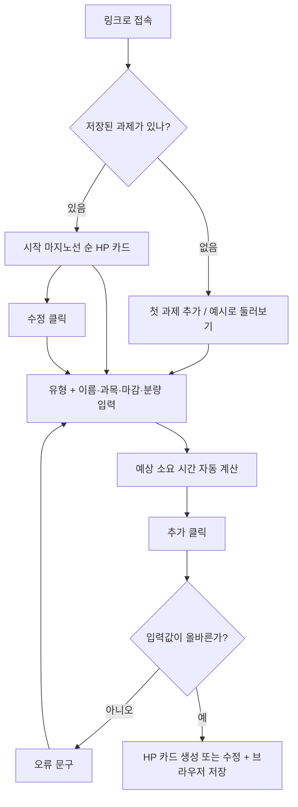
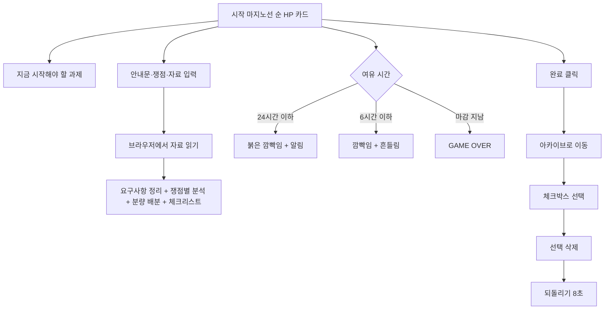

# PRD_과제 타이머 (v2)

Nov 25, 2026 · @sh

## 1. 프로젝트 개요

- **문제**: 대학생은 전공·교양 과제 마감이 겹치면 우선순위를 놓치기 쉽다. 흔한 투두리스트는 체크박스와 날짜만 있어서 위기감이 들지 않고, 과제가 얼마나 걸릴지도 알려 주지 않는다.
- **필요성**: 마감일을 '기억'하는 것과 '체감'하는 것은 다르다. 마감까지 남은 시간에서 필요한 작업 시간을 뺀 '여유'를 게임 체력(HP)처럼 보여 주면, 글을 읽지 않아도 가장 급한 과제와 시작해야 할 때를 바로 알 수 있다.
- **목적**: 과제 유형·이름·마감일시·분량만 입력하면 여유 시간을 HP 게이지로 보여 주고, '지금 시작해야 할 과제'와 과제 안내문·참고 자료를 바탕으로 만든 작성 가이드를 함께 제공해 "지금 무엇부터, 어떻게 할지"를 빠르게 정하게 한다.
- **한 줄 정의**: 여유 시간이 줄어들수록 체력이 깎이고 붉게 깜빡이는 HP 게이지로 과제 우선순위와 시작 시점을 알려 주는 대시보드, '과제 타이머'.

## 2. 주요 타겟

전공·교양 과제 마감이 겹칠 때 우선순위를 놓치기 쉬운 **대학생**.

- 보고서·PPT·문제풀이 등 형식이 다른 과제를 동시에 준비한다.
- 스마트폰으로 틈틈이 남은 과제를 확인한다.
- 회원가입 없이 링크로 바로 쓰기를 원한다.

## 3. 핵심 기능 (MVP)

HP는 '(마감까지 남은 시간 − 예상 소요 시간) ÷ 7일(168시간) × 100'으로 계산하며, 여유가 7일 이상이면 100%로 표시한다.

| 우선순위 | 기능 | 완료 기준 |
| --- | --- | --- |
| P1 | 과제 등록·수정 + 소요 시간 계산: 유형(보고서·PPT·문제풀이·기타), 이름, 과목, 마감일시, 분량, 단위당 시간을 입력하면 예상 소요 시간을 자동 계산. 마감은 '오늘·내일·금요일 23:59, 일주일 뒤' 버튼으로도 고를 수 있음 | 보고서 12쪽 × 30분을 넣으면 '예상 소요 6시간'이 바로 보이고, '추가' 후 1초 안에 카드가 생기며 새로고침해도 남아 있다. '수정'을 누르면 폼에 내용이 채워진다 |
| P1 | HP 대시보드 + 위기 경고 + 작성 가이드: 시작 마지노선 순으로 HP 카드를 보여 주고, 시작이 급한 과제는 '지금 시작해야 할 과제'에 모음. 과목별로 거를 수 있음. 과제 안내문과 참고 자료(PDF·한글·워드·PPT·엑셀·사진·스캔본)를 올리면 요구사항을 정리하고 쟁점별 분석·분량 배분·제출 전 체크를 자동으로 만들어 줌. 마감 24시간 전과 시작 마지노선 무렵에 알림 | 1분마다 갱신. HP 50% 초과 초록 / 20~50% 노랑 / 20% 미만 빨강, 여유 24시간 이하 깜빡임, 6시간 이하 흔들림(마우스를 올리거나 입력 중이면 멈춤). PDF·한글 안내문이나 안내문 사진을 올리면 분량·출처 형식·평가 기준·필수 항목이 정리되고, 쟁점마다 핵심 질문·분석 관점·근거 후보(자료 속 실제 문장과 파일 이름)가 나타난다. 근거를 찾지 못하면 지어내지 않고 '찾지 못했어요'라고 알린다 |
| P2 | 완료·정리·백업: 끝난 과제를 완료로 바꾸고, 체크박스로 골라 한 번에 삭제(8초 안에 되돌리기). 모든 과제를 백업 파일로 저장·복원하고, 캘린더 파일(.ics)로 내보냄 | '완료'를 누르면 아카이브로 이동하고, 선택 삭제 후 8초 동안 '되돌리기'가 뜬다. 백업 파일을 다른 브라우저에서 불러오면 과제가 그대로 복원된다 |

**없어도 되는 기능**: 진행률(%) 직접 입력, 완료 통계 그래프, 효과음, 라이트 모드.

## 4. 사용자 흐름 (User Flow)

1. 링크로 대시보드에 접속한다. 처음이면 '첫 과제 추가' 또는 '예시 과제로 둘러보기'를 고른다.
2. 휴대폰에서는 오른쪽 아래 '+ 새 과제', 컴퓨터에서는 빠른 등록 칸에서 과제를 등록한다.
3. 과제 유형을 고른다.
4. 과제 이름과 과목을 입력한다.
5. 마감 날짜와 시간을 고르거나 빠른 선택 버튼을 누른다.
6. 분량과 단위당 걸리는 시간을 입력하고 예상 소요 시간을 확인한다.
7. '추가' 버튼을 누른다.
8. '지금 시작해야 할 과제'와 시작 순서대로 정렬된 HP 카드를 확인한다.
9. 과제의 '자료·작성 가이드'를 연다.
10. 과제 안내문을 붙여 넣고, 주요 쟁점을 적고, 참고 자료(PDF 등)를 올린다.
11. 요구사항 요약, 쟁점별 분석, 분량 배분, 제출 전 체크를 보며 과제를 한다.
12. 필요하면 설정에서 알림을 켜거나 캘린더 파일을 저장한다.
13. 마감이나 분량이 바뀌면 '수정'으로 고친다.
14. 과제를 끝내면 '완료' 버튼을 누른다.
15. 아카이브에서 지울 과제를 골라 '선택 삭제'를 누른다.
16. 기기를 바꾸기 전에 설정에서 백업 파일을 저장한다.

### 예외 상황

- 이름·마감일시가 비었거나 마감이 과거 → 추가되지 않고 오류 문구 표시
- 분량은 넣었는데 단위당 시간이 0 이하 → 오류 문구 표시 (분량을 비우면 소요 시간 없이 등록)
- 남은 시간이 예상 소요 시간보다 적음 → '시간 부족' 배지, '지금 시작해도 n시간 모자라요' 안내
- 마감이 지났는데 미완료 → HP 0%, 회색 'GAME OVER' 카드, '마감 미루기'/'뒤늦게 완료'/'삭제' 선택
- 실수로 삭제함 → 8초 안에 '되돌리기'로 복구
- 사진·스캔 PDF → 글자 인식으로 읽음. 확실히 읽지 못한 낱말은 ▢로 표시하고, 그런 낱말은 요구사항에 쓰지 않음. ▢가 두 개 이상인 문장은 근거로 쓰지 않음
- 암호가 걸린 파일, 아주 오래된 한글(한글 97 이전), 브라우저가 열지 못하는 사진(HEIC) → 읽지 못한 이유와 해결 방법 안내
- 자료에서 쟁점 근거를 찾지 못함 → 근거를 지어내지 않고 '찾지 못했어요'와 찾아야 할 자료 안내
- 과제 안내문 파일 → 요구사항 정리에만 쓰고 근거 후보에는 쓰지 않음
- 알림이 차단됨 → 설정에서 차단 사실과 해제 방법 안내, 캘린더 파일 권장
- 저장할 수 없는 창(시크릿 모드 등) → 상단에 저장 불가 배너와 백업 권장
- 백업 파일이 아니거나 비어 있음 → 불러오지 않고 이유 안내

### 순서도

#### ① 과제 등록

#### ② 과제 관리

## 5. 입력과 출력

| 화면 | 입력 | 처리 | 출력 |
| --- | --- | --- | --- |
| 대시보드 (처음) | 없음 | 브라우저 저장소(IndexedDB)에서 과제 불러오기, 이전 버전 데이터 옮기기 | "아직 등록된 과제가 없어요" 안내, '첫 과제 추가'·'예시 과제로 둘러보기' 버튼 |
| 지금 시작해야 할 과제 | 없음 (자동) | 여유 시간 3시간 이하(분량 미입력이면 마감 24시간 이하)인 과제를 급한 순으로 최대 3개 | 붉은 상자, "2시간 안에 시작해야 해요" / "지금 시작해도 1시간 모자라요" |
| 과제 추가·수정 폼 | 유형 / 이름 1~30자 / 과목(선택) / 마감일시 또는 빠른 선택 / 분량 + 단위 / 단위당 시간(분) | 유형 선택 시 단위·기본 시간 자동 입력(보고서 쪽·40분, PPT 장·20분, 문제풀이 문제·5분), 소요 시간 = 분량 × 단위당 시간, 입력값 검사 | "예상 소요 6시간" 실시간 표시, '추가'(수정 중에는 '수정 저장'), 결과 문구 |
| 과제 카드 | 없음 (1분마다 갱신) | 여유 시간으로 HP 계산, 시작 마지노선 = 마감 − 소요 시간 | 유형 태그, 이름, 과목, 남은 시간, HP 바, 예상 소요·시작 마지노선, 깜빡임·흔들림, '시간 부족' 배지 |
| 자료·작성 가이드 | 과제 안내문(텍스트) / 쟁점(최대 6개) / 참고 자료(PDF·hwp·hwpx·doc·docx·ppt·pptx·xlsx·txt·사진) | 파일을 브라우저 안에서 읽어(한글 배포용 문서 포함, 사진과 스캔 쪽은 한국어·영어 글자 인식) 문장·핵심어·요구사항 추출(서버로 보내지 않음), 쟁점 유형(인과·비교·문제해결·찬반·이유·절차)에 맞춘 분석 틀, 자료 속 근거 문장 찾기 | 이 과제가 요구하는 것, 쟁점별 핵심 질문·분석 관점·근거 후보·예상 반론·쓰는 법, 분량 배분, 제출 전 체크리스트(체크 상태 저장), 지금 바로 할 일, 일정 팁 |
| 아카이브 | 체크박스, '전체 선택', '선택 삭제', '진행 중으로' | 기한 안 완료 비율로 생존율 계산 | 생존율 원그래프, CLEAR!/늦은 클리어 목록, GAME OVER 과제 |
| 설정 | 알림 켜기/끄기, 캘린더 저장, 백업 저장/불러오기, 예시 불러오기, 전체 삭제 | 알림 권한 요청, .ics·.json 파일 생성, 백업 검증 후 더하기 또는 바꾸기 | 알림 상태와 안내, 파일 저장, 불러온 과제 수, 삭제 확인 |

### 오류 문구 (입력칸 아래 빨간 글씨)

| 상황 | 문구 |
| --- | --- |
| 이름 미입력 | "과제 이름을 입력해 주세요." |
| 이름 30자 초과 | "과제 이름은 30자까지 입력할 수 있어요." |
| 마감일시 미선택 | "마감 날짜와 시간을 선택해 주세요." |
| 마감일시가 과거 | "이미 지난 시간이에요. 앞으로의 마감일을 골라 주세요." |
| 분량·시간 잘못 입력 | "분량과 단위당 시간을 1 이상의 숫자로 둘 다 입력해 주세요." |
| 추가 실패 (버튼 아래) | "빨간 안내가 있는 칸을 확인해 주세요." |
| 암호가 걸린 파일 | "암호가 걸린 파일이에요. 암호를 푼 뒤 저장해서 다시 올려 주세요." |
| 사진에서 글자를 못 찾음 | "사진에서 읽을 수 있는 글자를 찾지 못했어요. 글자가 화면을 채우도록 가까이, 밝은 곳에서 다시 찍어 올려 주세요." |
| 열 수 없는 사진(HEIC) | "이 브라우저는 이 사진 형식(HEIC)을 열지 못해요. 사진 앱에서 JPG로 내보내거나 화면을 캡처해서 올려 주세요." |
| 백업이 아닌 파일 | "백업 파일을 읽지 못했어요. 과제 타이머에서 저장한 .json 파일인지 확인해 주세요." |
| 저장 불가 (상단 배너) | "이 창에서는 저장이 안 돼요(시크릿 모드 등). 새로고침하면 과제가 사라지니 설정에서 백업 파일을 저장해 두세요." |

## 6. 제외 범위 (Out of Scope)

이번 버전은 서버와 데이터베이스 없이 브라우저 저장소(IndexedDB)에 저장하는 웹앱이다. 홈 화면에 설치할 수 있고(PWA), 인터넷이 끊겨도 저장된 과제를 볼 수 있다.

| 제외 기능 | 이유 | 비고 |
| --- | --- | --- |
| 로그인·회원가입 | 브라우저 저장과 백업 파일로 충분 | 2차 버전 |
| 서버·데이터베이스 (기기 간 자동 동기화) | 백업 파일 저장·불러오기로 대신 | 2차 버전 |
| AI(언어 모델) 분석 | 비용과 서버가 필요하고, 규칙 기반 자동 분석으로 요구사항·쟁점 정리를 제공 | 2차 버전 |
| 서버 푸시 알림 (앱을 완전히 닫았을 때) | 푸시 서버가 필요함. 앱이 열려 있을 때의 알림과 캘린더(.ics) 알림으로 대신 | 2차 버전 |
| 카카오톡·이메일 알림 | 외부 서비스 연동 필요 | 2차 버전 |
| 학교 LMS 과제 자동 불러오기 | 학교 시스템 접근 권한 없음 | 제외 |
| 손글씨 인식, 수식·표 구조 복원 | 브라우저 안 글자 인식으로는 정확도가 낮음 | 2차 버전 |
| 팀원과 과제 공유 | 개인용 대시보드로 한정 | 제외 |
