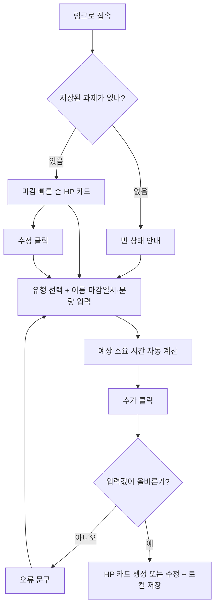
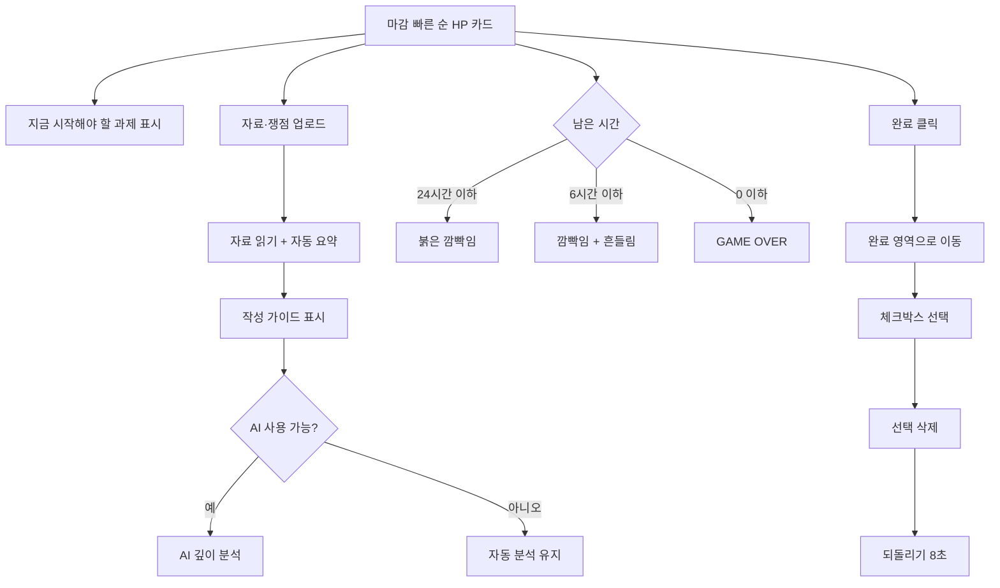

# PRD_과제 타이머

Nov 10, 2026 · @sh

## 1. 프로젝트 개요

- **문제**: 대학생은 전공·교양 과제 마감이 겹치면 우선순위를 놓치기 쉽다. 흔한 투두리스트는 체크박스와 날짜만 있어서 위기감이 들지 않고, 과제가 얼마나 걸릴지도 알려주지 않는다.
- **필요성**: 마감일을 '기억'하는 것과 '체감'하는 것은 다르다. 남은 시간을 게임 체력(HP)처럼 보여주고 필요한 작업 시간을 함께 알려주면, 글을 읽지 않아도 가장 급한 과제와 시작해야 할 때를 바로 알 수 있다.
- **목적**: 과제 유형·이름·마감일시·분량만 입력하면 남은 시간을 HP 게이지로 보여주고, 예상 소요 시간과 '지금 시작해야 할 과제', 올린 자료를 읽어 만든 작성 가이드를 함께 제공해 "지금 무엇부터, 어떻게 할지"를 빠르게 정하게 한다.
- **한 줄 정의**: 마감이 다가올수록 체력이 깎이고 붉게 깜빡이는 HP 게이지로 과제 우선순위와 소요 시간을 한눈에 보여주는 대시보드, '과제 타이머'.

## 2. 주요 타겟

전공·교양 과제 마감이 겹칠 때 우선순위를 놓치기 쉬운 **대학생**.

- 보고서·PPT·문제풀이 등 형식이 다른 과제를 동시에 준비한다.
- 스마트폰으로 틈틈이 남은 과제를 확인한다.
- 회원가입 없이 링크로 바로 쓰기를 원한다.

## 3. 핵심 기능 (MVP)

HP는 '마감까지 남은 시간 ÷ 7일(168시간) × 100'으로 계산하며, 7일 이상 남으면 100%로 표시한다.

| 우선순위 | 기능 | 완료 기준 |
| --- | --- | --- |
| P1 | 과제 등록·수정 + 분량·소요 시간 계산: 유형(보고서·PPT·문제풀이·기타), 이름, 마감일시, 분량, 단위당 시간을 입력하면 예상 소요 시간을 자동 계산. 등록한 과제는 '수정'으로 고칠 수 있음 | 보고서 12쪽 × 30분을 넣으면 '예상 소요 6시간'이 바로 보이고, '추가'(또는 이름 칸에서 Enter) 후 1초 안에 카드가 생기며 버튼 아래 "'○○' 과제를 추가했어요."가 뜬다. 새로고침해도 남아 있다. '수정'을 누르면 폼에 내용이 채워지고 '수정 저장'으로 바뀐다 |
| P1 | HP 게이지 대시보드 + 위기 경고 + 작성 가이드: 마감 빠른 순으로 HP 카드를 보여주고, 시작이 급한 과제는 맨 위 '지금 시작해야 할 과제'에 모음. 카드에 과제 내용·주요 쟁점·참고 자료를 올리면 자료를 읽어 요약하고 작성 가이드(쟁점 분석·구성안·제출 전 체크)를 보여줌 | 1분마다 갱신, HP 50% 초과 초록 / 20~50% 노랑 / 20% 미만 빨강, 24시간 이하 깜빡임, 6시간 이하 흔들림(마우스를 올리거나 패널을 펼치면 흔들림 멈춤). 시작 마지노선이 3시간 안이거나 지난 과제는 '지금 시작해야 할 과제'에 최대 3개 표시. PDF를 올리면 바로 핵심 문장·핵심어·요구사항이 나오고, 쟁점마다 핵심 질문·분석 관점·근거 후보·예상 반론·쓰는 법이 나타난다 |
| P2 | 완료 처리 + 선택 삭제 + 되돌리기: 끝난 과제를 완료로 바꾸고, 체크박스로 골라 한 번에 삭제. 실수로 지운 과제는 되돌림 | '완료'를 누르면 완료 영역으로 이동하고, 1개 이상 고르면 '선택 삭제 (n)' 버튼이 켜지며 고른 과제만 사라진다. 삭제 후 8초 동안 '되돌리기'가 떠서 누르면 복구된다 |

**없어도 되는 기능**: 과목별 색상 분류, 진행률(%) 직접 입력, 완료 통계 그래프, 효과음, 다크 모드 선택, AI에게 자유 질문(채팅).

## 4. 사용자 흐름 (User Flow)

1. 링크로 대시보드에 접속한다.
2. 처음 보이는 예시 과제를 '예시 지우기'로 지운다.
3. 과제 유형(보고서·PPT·문제풀이·기타)을 고른다.
4. 과제 이름을 입력한다.
5. 마감 날짜와 시간을 선택한다.
6. 분량과 단위당 걸리는 시간을 입력한다.
7. 예상 소요 시간을 확인한다.
8. '추가' 버튼을 누른다.
9. 맨 위 '지금 시작해야 할 과제'와 마감 빠른 순 HP 카드를 확인한다.
10. 급한 과제의 '자료·쟁점 올리고 작성 팁 보기'를 펼친다.
11. 과제 내용과 주요 쟁점을 적고 참고 자료(PDF 등)를 올린다.
12. 자료 요약과 작성 가이드(쟁점 분석·구성안·제출 전 체크)를 확인한다.
13. 필요하면 'AI로 깊이 분석하기'를 누른다.
14. 가이드를 보며 과제를 한다.
15. 마감이나 분량이 바뀌면 '수정'으로 고친다.
16. 과제를 끝내면 '완료' 버튼을 누른다.
17. 완료한 과제 중 지울 것을 체크박스로 고른다.
18. '선택 삭제' 버튼을 누른다.

### 예외 상황

- 이름·마감일시가 비었거나 마감이 과거 → 추가되지 않고 오류 문구 표시
- 분량·단위당 시간이 0 이하이거나 하나만 입력 → 오류 문구 표시 (둘 다 비우면 소요 시간 없이 등록)
- 남은 시간이 예상 소요 시간보다 적음 → '시간 부족' 배지
- 마감이 지났는데 미완료 → HP 0%, 회색 'GAME OVER' 카드, '완료'/'삭제' 선택
- 완료 과제를 하나도 고르지 않음 → '선택 삭제' 버튼 비활성
- 실수로 삭제함 → 8초 안에 '되돌리기'로 복구
- 한글(.hwp) 파일이나 스캔한 PDF → 내용을 읽지 못한다는 안내와 PDF·.hwpx 저장 또는 캡처 이미지 업로드 안내
- AI를 쓸 수 없는 환경(앱 밖, 사용 허용 거절) → 자동 분석으로 작성 가이드 표시
- 과제 정보나 자료가 바뀜 → '바뀐 내용 반영해 다시 분석' 안내
- 등록된 과제가 없음 → 빈 상태 안내 문구 표시
- 로컬 스토리지 사용 불가(시크릿 모드 등) → 상단에 저장 불가 배너 표시

### 순서도

#### ① 과제 등록

#### ② 과제 관리 (HP 카드 이후)

## 5. 입력과 출력

| 화면 | 입력 | 처리 | 출력 |
| --- | --- | --- | --- |
| 대시보드 (빈 상태) | 없음 (접속) | 로컬 스토리지에서 과제 불러오기 | 제목 "과제 타이머", 회색 문구 "아직 등록된 과제가 없어요. 첫 과제를 추가해 보세요!" |
| 예시 안내 | '예시 지우기' 클릭 | 예시 과제만 삭제 | "지금 보이는 과제 중 n개는 사용법을 보여 주는 예시예요." 안내와 버튼 |
| 지금 시작해야 할 과제 | 없음 (자동) | 남은 시간 − 소요 시간이 3시간 이하인 과제를 급한 순으로 최대 3개 | 노란 상자, "2시간 안에 시작해야 해요" / "지금 시작해도 1시간 모자라요" |
| 과제 추가·수정 폼 | 유형: 버튼 4개 중 1개 / 이름: 텍스트 1~30자 / 마감일시: 날짜+시간 / 분량: 숫자 + 단위(쪽·장·문제·개) / 단위당 시간: 숫자(분) | 유형 선택 시 단위·기본 시간 자동 입력(보고서 쪽·40분, PPT 장·20분, 문제풀이 문제·5분), 소요 시간 = 분량 × 단위당 시간, 입력값 검사 | "예상 소요 6시간" 실시간 표시, 파란 '추가' 버튼(수정 중에는 '수정 저장'·'취소'), 버튼 아래 결과 문구 |
| 과제 카드 | 없음 (1분마다 갱신) | HP 계산, 시작 마지노선 = 마감 − 소요 시간, 마감 빠른 순 정렬 | 유형 태그, 이름, "D-2 · 14시간 32분 남음", "예상 소요 6시간 · 시작 마지노선 11/5(목) 21:00", HP 바(초록·노랑·빨강), 깜빡임·흔들림(마우스 올리면 멈춤), '시간 부족' 배지, '수정'·'완료' 버튼 |
| 자료·쟁점 패널 | 과제 내용: 텍스트 / 주요 쟁점: 텍스트 여러 개 / 참고 자료: 파일 여러 개(PDF·docx·pptx·xlsx·hwpx·txt·이미지) | 브라우저에서 파일 글자를 읽어 핵심 문장·핵심어·요구사항 자동 추출, AI 사용 가능 시 AI 요약까지 자동 실행 | 쟁점 태그, 파일 목록과 파일별 요약, "자료를 읽고 요약하는 중이에요..." 표시, 일정·분량 팁 |
| 작성 가이드 | 'AI로 깊이 분석하기' 클릭(자료 업로드 후 자동 실행) | AI 사용 가능 시 과제 정보와 자료 본문을 읽고 구조화된 가이드 생성, 아니면 쟁점 형태(인과·비교·문제해결·찬반)에 맞춘 자동 분석 | '이 과제가 요구하는 것', 쟁점별 핵심 질문·분석 관점·근거 후보(출처 파일)·예상 반론·쓰는 법, 구성안(분량 배분), 제출 전 체크, 지금 바로 할 일, 'AI 분석'/'자동 분석' 표시 |
| 완료한 과제 영역 | 체크박스 선택, '완료 전체 선택', '선택 삭제' 클릭 | 선택한 과제만 삭제 후 저장, 8초간 되돌리기 가능 | 초록 "CLEAR!" 카드, "선택 삭제 (n)" 버튼(0개면 비활성), 하단 "n개를 삭제했어요 · 되돌리기" |

### 오류 문구 (입력칸 아래 빨간 글씨)

| 상황 | 문구 |
| --- | --- |
| 이름 미입력 | "과제 이름을 입력해 주세요." |
| 이름 30자 초과 | "과제 이름은 30자까지 입력할 수 있어요." |
| 마감일시 미선택 | "마감 날짜와 시간을 선택해 주세요." |
| 마감일시가 과거 | "이미 지난 시간이에요. 앞으로의 마감일을 골라 주세요." |
| 분량·시간 잘못 입력 | "분량과 걸리는 시간을 1 이상의 숫자로 둘 다 입력해 주세요." |
| 추가 실패 (버튼 아래) | "빨간 안내가 있는 칸을 확인해 주세요." |
| 한글 .hwp 업로드 (파일 아래) | "한글(.hwp)은 읽지 못해요. 한글에서 PDF나 .hwpx로 저장해 다시 올려 주세요." |
| 스캔 PDF (파일 아래) | "글자를 찾지 못했어요. 스캔한 PDF라면 페이지를 캡처해 이미지로 올리면 AI가 읽어요." |
| 저장 불가 (상단 노란 배너) | "이 창에서는 저장이 안 돼요. 새로고침하면 과제가 사라져요." |

## 6. 제외 범위 (Out of Scope)

이번 버전은 데이터베이스 없이 브라우저 로컬 스토리지에만 저장하는 한 페이지 웹앱이다. AI 분석은 별도 서버 없이 Claude 앱의 AI 기능을 사용자 계정으로 호출하며, 쓸 수 없을 때는 자동 분석으로 대신한다.

| 제외 기능 | 이유 | 비고 |
| --- | --- | --- |
| 로그인·회원가입 | 로컬 저장으로 충분, 가입을 귀찮아함 | 2차 버전 |
| 데이터베이스·서버 구축 (기기 간 동기화) | 로컬 스토리지 임시 저장으로 설계 | 2차 버전 |
| 자체 AI 서버·API 연동 | Claude 앱의 AI 기능과 브라우저 내 자동 분석으로 대신 | 2차 버전 |
| AI에게 자유 질문(채팅) | 작성 가이드에 집중, 화면이 복잡해짐 | 제외 |
| 푸시·카카오톡·이메일 알림 | 외부 서비스 연동 필요 | 2차 버전 |
| 구글 캘린더 연동 | 외부 API 인증 필요 | 2차 버전 |
| 학교 LMS 과제 자동 불러오기 | 학교 시스템 접근 권한 없음 | 제외 |
| 실제 휴대폰 진동 | 화면 흔들림 애니메이션으로 대신 | 2차 버전 |
| 팀원과 과제 공유 | 개인용 대시보드로 한정 | 제외 |
